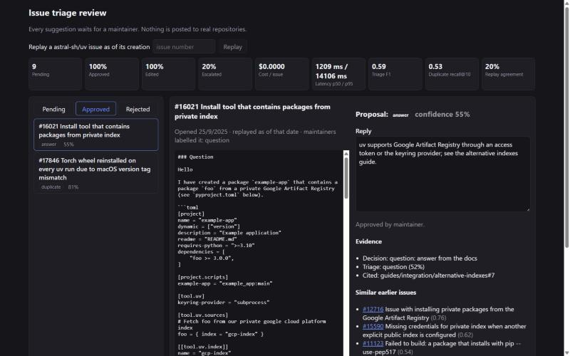
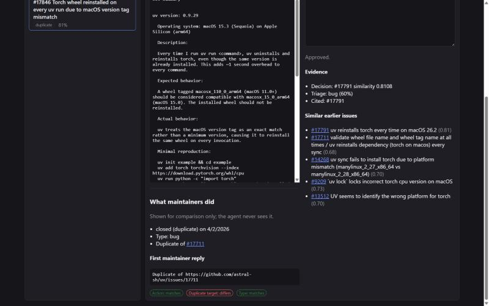
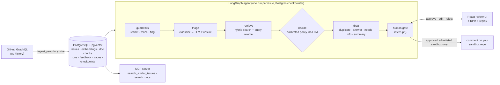

# AI Issue Triage

**A new issue arrives; the system labels it, looks for earlier duplicates, drafts a reply grounded in the project's docs, and a maintainer decides.** An issue-triage copilot built on hybrid retrieval (pgvector + BM25), a LangGraph agent with a human gate, and a trained decision model, measured against what the maintainers of [astral-sh/uv](https://github.com/astral-sh/uv) actually did with 9,411 real issues.



> **Portfolio project.** It learns from and is evaluated on uv's public issue history, pseudonymized. It **never posts to real repositories**: it replays historical issues, and live mode only works on sandbox repositories you own ([D-003](DECISIONS.md#d-003-never-post-to-real-repositories), [D-014](DECISIONS.md#d-014-live-mode-only-for-allowlisted-sandboxes-posting-guarded-in-one-place)). Every model-backed step runs on a deterministic fake by default, so the numbers below are the **zero-spend baseline** a real model has to beat ([D-007](DECISIONS.md#d-007-build-on-a-fake-llm-and-local-models-run-gates-without-the-frameworks-adoption-matrix)). Built with [ai-harness-framework](https://github.com/maideps/ai-harness-framework): one feature at a time, each through layered verification gates.

**Stack:** FastAPI · PostgreSQL + pgvector · SQLAlchemy + Alembic · LangGraph (Postgres checkpointer) · LiteLLM · sentence-transformers · scikit-learn · rank-bm25 · MCP Python SDK · React + TypeScript + Vite · Docker Compose · GitHub Actions

## Run it in five minutes

All you need is Docker with Compose v2.

```bash
git clone https://github.com/maideps/ai-issue-triage.git
cd ai-issue-triage
docker compose up --build
```

Open **http://localhost:8080** once the `seed` container prints `demo ready`. The first build downloads CPU-only PyTorch and bakes the embedding model into the image (about 10 minutes, 2.7 GB); later starts take seconds. The seed loads a committed sample (400 pseudonymized and redacted uv issues plus the uv docs snapshot, [`samples/demo/`](samples/demo/)), embeds and indexes it, and queues 8 golden issues. No API key, no spend. Then:

1. Open a suggestion in **Pending**: the original issue sits beside the drafted reply, its evidence (the rule that chose the action, the triage label, cited doc chunks) and similar earlier issues.
2. **Approve**, edit and **Approve edited**, or **Reject**. The agent run resumes from its checkpoint and the decision is stored as feedback.
3. Type any issue number from the sample into **Replay** to triage it as of its creation date and compare with what maintainers did.

Change ports with `ISSUE_TRIAGE_WEB_PORT` / `ISSUE_TRIAGE_DB_PORT`; `docker compose down -v` removes the data.

## Results

Every number links to the summary file it comes from. All evaluations are **time-split**: an issue is only ever compared with issues and docs that existed before it was opened ([D-004](DECISIONS.md#d-004-time-split-evaluation)).

| What | Ground truth (from maintainers) | Result | Reference |
|---|---|---|---|
| Type triage, 1,543 test issues | Their type labels | Macro-F1 **[0.592](evals/results/decision-model-test.json)** with a trained classifier that sends only 34% of issues to the LLM step | Always "bug": [0.143](evals/results/type-fake-triage-keywords-test.json); keyword LLM stand-in: [0.526](evals/results/decision-model-test.json) |
| Duplicate detection, 319 pairs | The original they linked | Recall@10 **[0.527](evals/results/rerank-all.json)**, MRR@10 [0.278](evals/results/rerank-all.json) (hybrid search + query rewriting) | Vector only [0.398](evals/results/duplicates-all.json), BM25 only [0.401](evals/results/duplicates-all.json) |
| Doc retrieval, 50 test questions | The docs page they linked when answering | MRR **[0.305](evals/results/chunking-test.json)** with heading chunks | Fixed windows [0.290](evals/results/chunking-test.json) |
| Doc-grounded answers, 370 test questions | Their first reply | Citation validity **[1.00](evals/results/answers-test.json)**, lexical faithfulness [0.71](evals/results/answers-test.json), same docs page as the maintainer in [24%](evals/results/answers-test.json) | Fake extractive drafter ([D-010](DECISIONS.md#d-010-native-llm-free-answer-metrics-until-a-judge-model-is-configured)) |
| Whole agent, 100 replayed test issues | Their action (duplicate, answer, ask for a repro) | Same action **[25%](evals/results/replay-test.json)**, macro-F1 over the four actions [0.360](evals/results/replay-test.json) with calibrated routing | Hand-written rules: [20%](evals/results/replay-test-legacy.json), [0.299](evals/results/replay-test-legacy.json) ([D-015](DECISIONS.md#d-015-calibrated-routing-a-needs-info-classifier-and-tuned-thresholds)) |

Two results worth reading in full: a general-purpose cross-encoder reranker **lowered** duplicate recall@10 to [0.455](evals/results/rerank-all.json) at five times the latency, so it ships disabled ([D-009](DECISIONS.md#d-009-query-rewriting-on-cross-encoder-reranking-off-for-duplicate-search)); and the components score well while the end-to-end agent agreed with maintainers on only a fifth of actions. Calibrating the routing on the train split lifted that to a quarter; what is left sits upstream, in duplicate retrieval and in recognising questions. More detail in [`evals/results/`](evals/results/README.md).



## How it works



- **Guardrails** treat issue text as untrusted: secrets and emails are redacted before any model sees them, the body is fenced as data, injection phrases send the issue to a human, and model output is scrubbed again ([architecture](docs/ARCHITECTURE.md)).
- **Triage** is a logistic regression over the issue embeddings; only issues it is unsure about reach the LLM step ([D-012](DECISIONS.md#d-012-a-trained-classifier-triages-first-and-escalates-to-the-llm-below-05-confidence)).
- **Retrieval** fuses pgvector embeddings and BM25 with reciprocal rank fusion, after an LLM step rewrites the issue into focused queries, always restricted to issues created before the one being triaged.
- **The agent** is one LangGraph flow whose nodes see only the state they declare; a failed run resumes from its last completed node, and every proposal stops at an `interrupt()` until a maintainer decides ([D-011](DECISIONS.md#d-011-one-langgraph-flow-rule-based-routing-a-human-gate-on-every-proposal)).
- **Observability**: every node and model call is traced with tokens, cost and latency; the UI shows live KPIs next to the offline results ([docs/OBSERVABILITY.md](docs/OBSERVABILITY.md#product-observability-feat-017)).

## Design decisions

| | Decision |
|---|---|
| [D-001](DECISIONS.md#d-001-astral-shuv-as-the-evaluation-target) | astral-sh/uv as the target: measured label coverage and duplicate links beat 12 other candidates |
| [D-003](DECISIONS.md#d-003-never-post-to-real-repositories) / [D-014](DECISIONS.md#d-014-live-mode-only-for-allowlisted-sandboxes-posting-guarded-in-one-place) | Never post to real repositories; one guarded publisher, allowlist only, the evaluation target always refused |
| [D-004](DECISIONS.md#d-004-time-split-evaluation) | Time-split evaluation everywhere |
| [D-007](DECISIONS.md#d-007-build-on-a-fake-llm-and-local-models-run-gates-without-the-frameworks-adoption-matrix) | Deterministic fake LLM and local models until a key is added |
| [D-008](DECISIONS.md#d-008-heading-based-chunks-with-a-local-384-dimension-embedding-model) | Heading-based doc chunks, chosen on maintainer-linked pages |
| [D-009](DECISIONS.md#d-009-query-rewriting-on-cross-encoder-reranking-off-for-duplicate-search) | Query rewriting on, cross-encoder reranking off, both measured |
| [D-010](DECISIONS.md#d-010-native-llm-free-answer-metrics-until-a-judge-model-is-configured) | LLM-free answer metrics until a judge model exists |
| [D-011](DECISIONS.md#d-011-one-langgraph-flow-rule-based-routing-a-human-gate-on-every-proposal) | One agent graph, rule-based routing, a human gate on every proposal |
| [D-012](DECISIONS.md#d-012-a-trained-classifier-triages-first-and-escalates-to-the-llm-below-05-confidence) | A trained classifier triages first and escalates when unsure |
| [D-013](DECISIONS.md#d-013-replay-mode-compares-with-maintainers-the-decision-rules-need-calibration) | Replay against maintainers; the routing rules need calibration |
| [D-015](DECISIONS.md#d-015-calibrated-routing-a-needs-info-classifier-and-tuned-thresholds) | Calibrated routing: a needs-info classifier and thresholds tuned on the train split |

All decisions, with context and alternatives: [DECISIONS.md](DECISIONS.md).

## Known limitations

- **No real model has run yet.** The LLM steps run on deterministic fakes; to run real models, set a provider key and map steps in `ISSUE_TRIAGE_LLM_MODELS` (see [`backend/.env.example`](backend/.env.example)), then rerun the evaluations.
- **End-to-end agreement is still modest.** After calibration (D-015) the agent picks the maintainers' action 25% of the time; duplicate recall is limited by retrieval and answer recall by triage recognising questions.
- **Live mode has not been run against a real sandbox**, only with a recording publisher in tests (D-014).
- **The golden sample's labels** are the maintainers', checked against titles by the author's assistant; a human review is still pending ([`evals/datasets/`](evals/datasets/README.md)).

## Going further

- [docs/PIPELINE.md](docs/PIPELINE.md): every stage as a command, from ingesting the full uv history to the evaluations, the agent CLI, the MCP server and live mode.
- [docs/ARCHITECTURE.md](docs/ARCHITECTURE.md): layers, modules and their rules. [docs/PRODUCT.md](docs/PRODUCT.md): users, flows and constraints.
- `claude mcp add ai-issue-triage -- node tools/py.mjs -m issue_triage mcp` exposes the search tools to any MCP client ([docs/TOOLS.md](docs/TOOLS.md)).

## Development

Requires Node.js ≥ 18 (the harness), Python ≥ 3.11, Docker for PostgreSQL, and the GitHub CLI for ingestion.

```bash
./init.sh                       # verify the environment
npm run setup:backend           # backend virtualenv with dev tools
npm run setup:frontend          # frontend dependencies
docker compose up -d db         # PostgreSQL 16 + pgvector on :5433
npm run check                   # lint → typecheck → test → build → e2e (backend and frontend)
npm run check-arch              # architecture rules
```

| Layer | Command | What it checks |
|-------|---------|----------------|
| 1 | `make lint` / `npm run lint` | Harness lint, ruff |
| 1b | `make typecheck` / `npm run typecheck` | mypy --strict, tsc |
| 2 | `make test` / `npm run test` | pytest (209 tests, database included), Vitest |
| 3 | `make build` / `npm run build` | Python compile check, Vite build |
| 3b | `make e2e` / `npm run e2e` | Harness end-to-end matrix |

Layers that are not configured report **SKIP** and do not count as verified. Database tests skip when PostgreSQL is down unless `ISSUE_TRIAGE_REQUIRE_DB=1` (CI and the feature gates set it). CI also runs a golden-set evaluation gate. The complete command list: [Harness Command Reference](docs/HARNESS.md) (regenerate with `npm run harness-docs`).

State files: `feature_list.json` (feature declarations), `.harness/state/<id>.json` (evidence per feature), `PROGRESS.md` and `progress/` (session notes), `DECISIONS.md`, `session-handoff.md`. Other docs: [Learning Log](docs/learning-log/README.md), [Observability](docs/OBSERVABILITY.md), [Tools & MCP](docs/TOOLS.md), [Usage Guide](docs/USAGE.md), [Quality Document](docs/quality-document.md).

## License

MIT — see [LICENSE](LICENSE). The uv documentation in `samples/demo/docs/` belongs to Astral and the uv contributors and is included under its own license ([notice](samples/demo/docs/NOTICE.md)).
