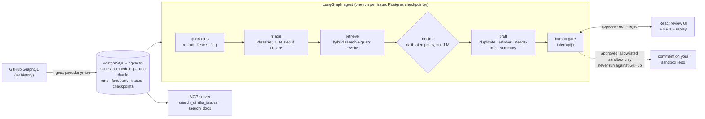

# AI Issue Triage

**For each new issue, the system proposes a type label, finds earlier issues that may be duplicates, and prepares a draft response for a maintainer to approve, edit or reject.** It combines hybrid retrieval (pgvector + BM25), a LangGraph agent that always stops for human review, and two small trained classifiers. Every component is evaluated against what the maintainers of [astral-sh/uv](https://github.com/astral-sh/uv) actually did with 9,411 real issues, opened between October 2023 and October 2026.


> **Portfolio project, read this first.**
> - **No real language model has been used.** Every step that would call an LLM runs on a deterministic stand-in, because no API key was configured ([D-007](DECISIONS.md#d-007-build-on-a-fake-llm-and-local-models-run-gates-without-the-frameworks-adoption-matrix)). The numbers below are a **zero-spend baseline**; plugging in a real model is a settings change, but it has not been done.
> - **It never posts to real repositories.** It replays historical uv issues. Live mode only works on sandbox repositories you own, and has only been exercised in tests ([D-003](DECISIONS.md#d-003-never-post-to-real-repositories), [D-014](DECISIONS.md#d-014-live-mode-only-for-allowlisted-sandboxes-posting-guarded-in-one-place)).
> - Usernames are pseudonymized and pasted secrets redacted. Built with [ai-harness-framework](https://github.com/maideps/ai-harness-framework), one feature at a time, each through layered verification gates.

**Stack:** FastAPI · PostgreSQL + pgvector · SQLAlchemy + Alembic · LangGraph (Postgres checkpointer) · sentence-transformers (local) · scikit-learn · rank-bm25 · LiteLLM (wired for real models, unused so far) · MCP Python SDK · React + TypeScript + Vite · Docker Compose · GitHub Actions

## What is real and what is a stand-in

| Part | Status |
|---|---|
| Issue ingestion (GitHub GraphQL), pseudonymization, PostgreSQL storage | Real; ran on the full uv history |
| Embeddings (`all-MiniLM-L6-v2`, local), BM25, pgvector search, rank fusion | Real |
| Type classifier and needs-info classifier (logistic regression on embeddings) | Real, trained on maintainers' labels |
| LangGraph agent: checkpoints, resume after failure, human gate | Real |
| Review UI, replay mode, KPIs, MCP server, Docker demo | Real |
| Guardrails (secret/email redaction, injection flags) | Real, rule-based |
| Triage when the classifier is unsure | Stand-in: keyword heuristic |
| Query rewriting before search | Stand-in: extracts the title, first error line and inline code |
| Answer drafting | Stand-in: quotes the most relevant doc excerpt and cites it |
| Answer judge (score 1-5) | Stand-in: word overlap with the maintainer reply |
| Duplicate and "please share a reproduction" replies | Fixed templates |
| Posting approved replies to GitHub | Implemented and unit-tested; never run against a real repository |
| Cost and token figures | Cost is always $0; tokens are estimated (characters / 4) |

## Run it in five minutes

You need Docker with Compose v2 and about 4 GB of free disk space.

```bash
git clone https://github.com/maideps/ai-issue-triage.git
cd ai-issue-triage
docker compose up --build
```

Open **http://localhost:8080** once the `seed` container prints `demo ready`. The first build downloads CPU-only PyTorch and bakes the embedding model into the image (about 10 minutes, a 2.7 GB image); later starts take seconds. The seed loads a committed sample (400 pseudonymized and redacted uv issues plus the uv docs snapshot, [`samples/demo/`](samples/demo/)), embeds and indexes it, and queues 8 issues from the golden set. No API key, no spend. Then:

1. Open a suggestion under **Pending**. The original issue sits beside the proposed response, with its evidence (why that action was chosen, the triage label, cited doc chunks) and similar earlier issues.
2. **Approve**, edit and **Approve edited**, or **Reject**. The agent run resumes from its checkpoint and the decision is stored as feedback. Nothing is posted anywhere.
3. Type an issue number **from the sample** into **Replay** to triage it as it was when opened, and compare with what maintainers did.

**The demo is not the evaluated configuration.** The two trained classifiers and the calibrated routing need the full issue history, which is not committed, so the demo triages every issue with the keyword stand-in and uses the original hand-written routing rules. Expect weaker suggestions than the numbers below; [docs/PIPELINE.md](docs/PIPELINE.md) rebuilds the full setup.

Change ports with `ISSUE_TRIAGE_WEB_PORT` (default 8080) and `ISSUE_TRIAGE_DB_PORT` (default 5433, also published); `docker compose down -v` removes the data.

## Results

Every number links to the summary file it comes from. All evaluations are **time-split**: an issue is only ever compared with issues and docs that existed before it was opened, and the test split is the newest 20% of issues, opened from 12 September 2025 ([D-004](DECISIONS.md#d-004-time-split-evaluation)). "LLM step" below means the stand-in described above.

| What | Ground truth (from maintainers) | Result | Reference |
|---|---|---|---|
| Type triage, 1,543 test issues | Their type labels | Macro-F1 **[0.592](evals/results/decision-model-test.json)**: the trained classifier decides, and sends the 34% it is unsure about to the LLM step | Always "bug": [0.143](evals/results/type-fake-triage-keywords-test.json); LLM step alone: [0.526](evals/results/decision-model-test.json) |
| Duplicate detection, 319 pairs | The original they linked | Recall@10 **[0.527](evals/results/rerank-all.json)**, MRR@10 [0.278](evals/results/rerank-all.json) (hybrid search with query rewriting) | Vector only [0.398](evals/results/duplicates-all.json), BM25 only [0.401](evals/results/duplicates-all.json) |
| Doc retrieval, 50 test questions | The docs page they linked when answering | MRR **[0.305](evals/results/chunking-test.json)** with heading chunks | Fixed-size windows [0.290](evals/results/chunking-test.json) |
| Answer drafts, 370 test questions | Their first reply | Every citation points at a retrieved chunk ([1.00](evals/results/answers-test.json)); 71% of draft sentences are supported by the cited text ([0.71](evals/results/answers-test.json)); the draft cites the page the maintainer linked in [24%](evals/results/answers-test.json) of cases | Measures the extractive stand-in, not a real model ([D-010](DECISIONS.md#d-010-native-llm-free-answer-metrics-until-a-judge-model-is-configured)) |
| Whole agent, 100 replayed test issues | Their action: duplicate, answer, ask for a reproduction, or none of these | Same action **[25%](evals/results/replay-test.json)** of the time, macro-F1 over the four actions [0.360](evals/results/replay-test.json), with calibrated routing | Hand-written routing: [20%](evals/results/replay-test-legacy.json), [0.299](evals/results/replay-test-legacy.json) ([D-015](DECISIONS.md#d-015-calibrated-routing-a-needs-info-classifier-and-tuned-thresholds)) |

How to read this:

- **Retrieval and classification are real and useful on their own.** Hybrid search finds the maintainer-linked original in the top 10 for about half of the duplicates; the trained classifier beats the stand-in without any LLM call.
- **End to end, the agent is not yet good.** It chooses the same action as the maintainers in a quarter of cases. Calibrating the routing on the train split helped (from 20%), and what remains is upstream: duplicate retrieval and recognising questions.
- **A negative result:** a general-purpose cross-encoder reranker *lowered* duplicate recall@10 to [0.455](evals/results/rerank-all.json) at more than five times the latency, so it ships disabled ([D-009](DECISIONS.md#d-009-query-rewriting-on-cross-encoder-reranking-off-for-duplicate-search)).

More detail and the full tables: [`evals/results/`](evals/results/README.md).


## How it works



- **Guardrails** treat issue text as untrusted: secrets and emails are redacted before any model step sees them, the body is fenced as data, injection phrases mark the suggestion as needing attention, and output is scrubbed again ([architecture](docs/ARCHITECTURE.md)).
- **Triage** is a logistic regression over the issue embedding; only issues it is unsure about (confidence below 0.5) go to the LLM step ([D-012](DECISIONS.md#d-012-a-trained-classifier-triages-first-and-escalates-to-the-llm-below-05-confidence)).
- **Retrieval** fuses pgvector embeddings and BM25 with reciprocal rank fusion, after the issue is rewritten into focused queries, and only ever searches issues created before the one being triaged.
- **Decide** is code, not a model: a policy picks one of four actions from the triage label, the best duplicate similarity and the needs-info classifier's probability, with thresholds tuned on the train split ([D-015](DECISIONS.md#d-015-calibrated-routing-a-needs-info-classifier-and-tuned-thresholds)).
- **The agent** is one LangGraph flow whose nodes see only the state they declare; a failed run resumes from its last completed node, and every proposal stops at an `interrupt()` until a person decides ([D-011](DECISIONS.md#d-011-one-langgraph-flow-rule-based-routing-a-human-gate-on-every-proposal)).
- **Observability**: each node is traced with its duration and status, and each model call with its step, model, tokens and cost; the UI shows live KPIs next to the offline results ([docs/OBSERVABILITY.md](docs/OBSERVABILITY.md#product-observability-feat-017)).

## Design decisions

| | Decision |
|---|---|
| [D-001](DECISIONS.md#d-001-astral-shuv-as-the-evaluation-target) | astral-sh/uv as the target: its label coverage and duplicate links measured best among 13 candidates |
| [D-003](DECISIONS.md#d-003-never-post-to-real-repositories) / [D-014](DECISIONS.md#d-014-live-mode-only-for-allowlisted-sandboxes-posting-guarded-in-one-place) | Never post to real repositories; one guarded publisher, allowlist only, the evaluation target always refused |
| [D-004](DECISIONS.md#d-004-time-split-evaluation) | Time-split evaluation everywhere |
| [D-007](DECISIONS.md#d-007-build-on-a-fake-llm-and-local-models-run-gates-without-the-frameworks-adoption-matrix) | Deterministic stand-ins for the LLM and local models until a key is added |
| [D-008](DECISIONS.md#d-008-heading-based-chunks-with-a-local-384-dimension-embedding-model) | Heading-based doc chunks, chosen on maintainer-linked pages |
| [D-009](DECISIONS.md#d-009-query-rewriting-on-cross-encoder-reranking-off-for-duplicate-search) | Query rewriting on, cross-encoder reranking off, both measured |
| [D-010](DECISIONS.md#d-010-native-llm-free-answer-metrics-until-a-judge-model-is-configured) | LLM-free answer metrics until a judge model exists |
| [D-011](DECISIONS.md#d-011-one-langgraph-flow-rule-based-routing-a-human-gate-on-every-proposal) | One agent graph, code-based routing, a human gate on every proposal |
| [D-012](DECISIONS.md#d-012-a-trained-classifier-triages-first-and-escalates-to-the-llm-below-05-confidence) | A trained classifier triages first and escalates when unsure |
| [D-013](DECISIONS.md#d-013-replay-mode-compares-with-maintainers-the-decision-rules-need-calibration) | Replay against maintainers showed routing as the weak spot |
| [D-015](DECISIONS.md#d-015-calibrated-routing-a-needs-info-classifier-and-tuned-thresholds) | Calibrated routing: a needs-info classifier and thresholds tuned on the train split |

All decisions, with context and alternatives: [DECISIONS.md](DECISIONS.md).

## Known limitations

- **No real model has run.** To try one, set a provider key and map steps in `ISSUE_TRIAGE_LLM_MODELS` (see [`backend/.env.example`](backend/.env.example)), then rerun the evaluations; the thresholds were tuned against the stand-ins and would need re-tuning.
- **End-to-end quality is modest**: 25% action agreement with maintainers (see Results).
- **One repository.** Everything was built and measured on uv; how it transfers to another tracker is untested.
- **Local use only.** The API and UI have no authentication; anyone who can reach them can approve suggestions.
- **Live mode** has not been run against a real GitHub repository, only with a recording publisher in tests (D-014).
- **The golden sample's labels** are the maintainers'; they were checked against titles by an AI assistant, and a human review is still pending ([`evals/datasets/`](evals/datasets/README.md)).
- **The Docker demo** runs without the trained classifiers and the calibrated routing (see above).

## Going further

- [docs/PIPELINE.md](docs/PIPELINE.md): every stage as a command, from ingesting the full uv history to the evaluations, routing calibration, the agent CLI, the MCP server and live mode.
- [docs/ARCHITECTURE.md](docs/ARCHITECTURE.md): layers, modules and their rules. [docs/PRODUCT.md](docs/PRODUCT.md): users, flows and constraints.
- `claude mcp add ai-issue-triage -- node tools/py.mjs -m issue_triage mcp` (from the repository root, with the database loaded) exposes the two search tools to any MCP client ([docs/TOOLS.md](docs/TOOLS.md)).

## Development

Requires Node.js ≥ 18 (the harness), Python ≥ 3.11, Docker for PostgreSQL, and the GitHub CLI (or `ISSUE_TRIAGE_GITHUB_TOKEN`) for ingestion.

```bash
./init.sh                       # verify the environment
npm run setup:backend           # backend virtualenv with dev tools
npm run setup:frontend          # frontend dependencies
docker compose up -d db         # PostgreSQL 16 + pgvector on :5433
npm run check                   # all verification layers, backend and frontend
npm run check-arch              # architecture rules
```

| Layer | Command | What it checks |
|-------|---------|----------------|
| 1 | `make lint` / `npm run lint` | Harness lint, ruff |
| 1b | `make typecheck` / `npm run typecheck` | mypy --strict, tsc |
| 2 | `make test` / `npm run test` | pytest (217 tests, database included), Vitest (10 tests) |
| 3 | `make build` / `npm run build` | Python compile check, Vite build |
| 3b | `make e2e` / `npm run e2e` | The harness's own end-to-end matrix |
| — | `make quality` / `npm run quality` | Metric gates; currently disabled, reports SKIP |

Layers that are not configured report **SKIP** and do not count as verified. Database tests skip when PostgreSQL is down unless `ISSUE_TRIAGE_REQUIRE_DB=1` (CI and the feature gates set it). CI also runs a golden-set evaluation gate that fails if triage drops more than 0.02 macro-F1 below the committed baseline. The complete command list: [Harness Command Reference](docs/HARNESS.md) (regenerate with `npm run harness-docs`).

State files: `feature_list.json` (feature declarations), `.harness/state/<id>.json` (evidence per feature), `PROGRESS.md` and `progress/` (session notes), `DECISIONS.md`, `session-handoff.md`. Other docs: [Learning Log](docs/learning-log/README.md), [Observability](docs/OBSERVABILITY.md), [Tools & MCP](docs/TOOLS.md), [Usage Guide](docs/USAGE.md), [Quality Document](docs/quality-document.md).

## License

MIT — see [LICENSE](LICENSE). The uv documentation in `samples/demo/docs/` belongs to Astral and the uv contributors and is included under its own license ([notice](samples/demo/docs/NOTICE.md)).
